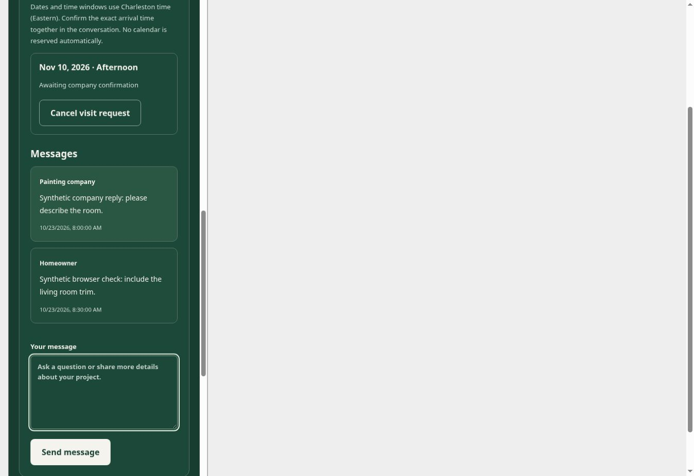
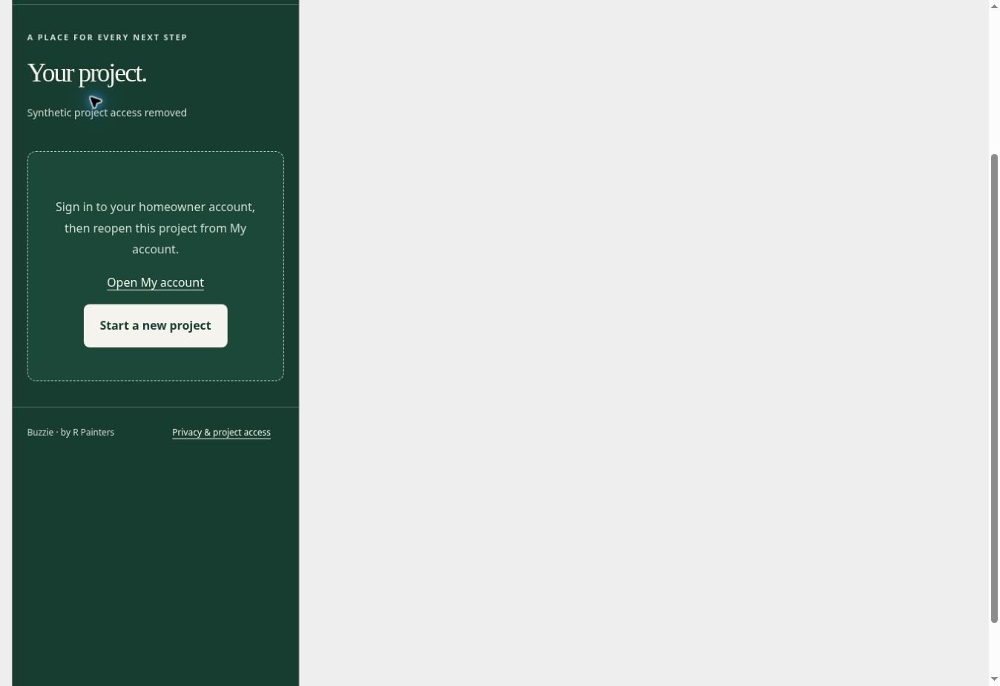

# Synthetic project workspace browser QA — October 23, 2026

Reviewed desktop Chromium against production baseline `1f55fed`. This run adds
fixture tools, tests and evidence only; production modules are unchanged.

## Replay and boundaries

With Node 24 and a fresh absolute directory under `/workspace/`:

```sh
node painting-platform/tests/project-browser-preview.mjs /workspace/buzzie-project-qa
sites-preview start /workspace/buzzie-project-qa
```

Open `http://terminal.local:4173/qa.html`. Choose account, capability or denied at
320/390/768px. Account mode seeds only a synthetic session; it does not sign in.
Capability mode clears that session and uses a fixed synthetic private key.
Fill only synthetic message/visit data. The local QA denial button makes future
private operations return synthetic 403. Never publish this output. Stop the
preview with `sites-preview stop` afterward.

The fetch stub never forwards to native fetch. It accepts only selected POST
lookup/conversation/message/visit-request calls with matching synthetic identity;
Auth, Storage, intake, claims, contractor actions and visit-update are blocked.
Other transports/sendBeacon are blocked. Every copied HTML page receives CSP
with connect-src/form-action none before the stub. Counters record only route,
method and action, never payloads or credentials. Message/visit state is in memory
and resets per page. Five Node boundary tests cover these contracts and production
module/CSS equality. Full verification: 12 modules linked, 356 tests pass.

## Observed Chromium journeys

| Scenario | Frame | Evidence |
| --- | --- | --- |
| Seeded account project | 390px | Account-only link explains sign-in is required; no Remember/key-based sharing control. Enter sends one synthetic message and the message appears in history with saved feedback. |
| Visit request | 390px | November 10 / Afternoon submitted with Enter. Feedback and visit show Awaiting company confirmation; cancel control appears; the project callback refreshes lookup. Counters reach two lookups, one message and one visit. |
| Denial after loaded project | 390px | Local QA denial button, then Enter on Refresh project status: synthetic 403, recovery guidance, project-content hidden, old contact text absent and zero textarea controls. Counters: three lookups, one message, one visit. |
| Independent key | 320px | Fresh capability scenario shows project/conversation without seeded account; Keep your private link, Remember and manual account-link controls remain. No claim/write invoked. |

Document and scroll widths matched: 375px for the loaded account workspace,
390px for its short denial page, 305px for the capability view. These are desktop
narrow-frame checks, not physical phones. No photo selected, live API/Auth call,
company website/phone navigation, account linking or actual notification occurred.





## Confirmed next correction

After Enter on Request a site visit, the successful refresh replaces its form
with the requested-visit card. Read-only DOM inspection confirmed focus on BODY.
The saved feedback/visit are accurate, but keyboard continuity is incomplete.
Correct this with a current-panel focus-ownership guard: transfer to a useful
visible control/heading only when the submit action still owns focus; preserve
newer user choices and suppress stale/detached/session-changed focus effects.
Then add meaningful race tests and repeat the same synthetic browser path.
This finding is not fixed by the fixture or this evidence commit.

## Proof limits

These are UI integration checks against synthetic replies and a seeded session.
They do not establish genuine JWT/Auth, gateway/RLS isolation, cross-account or
cross-tab session propagation, delivery, actual CAPTCHA/global abuse enforcement,
real Storage cleanup, physical devices or screen readers. Existing Node/SQL
checks remain distinct evidence. Site publication is unchanged; pending tested
conversation corrections still require source reconciliation after publishing
authorization recovery. No migration, runtime, real contractor or audience change.
